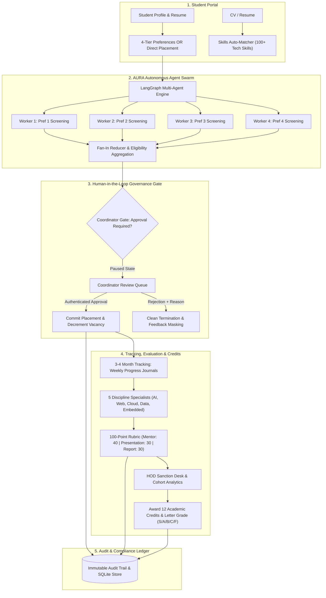

# InternTrack (AURA)
### Autonomous University Regulatory Assistant & Multi-Agent Internship Lifecycle Platform

[](https://www.python.org/)
[](https://github.com/langchain-ai/langgraph)
[-success.svg)](./run_master_verification_1_to_14.py)
[](#-guiding-institutional-principle)
[](https://interntrack-internship-tracking-portal.onrender.com)
[](LICENSE)

> **Live Cloud Instance:** [https://interntrack-internship-tracking-portal.onrender.com](https://interntrack-internship-tracking-portal.onrender.com)  
> **Course / Reference:** 26ECAC401 Agentic AI — 15 Worklets / 14-Lab Build Book (Chapter 10 Capstone)  
> **Institution:** KLE Technological University, Hubballi

---

## 📌 Executive Summary

**InternTrack (AURA)** is an enterprise-grade, full-stack regulatory platform designed to govern the entire university internship lifecycle under **AICTE** and **NEP 2020** mandates (awarding 12 academic credits). 

It bridges the divide between institutional regulatory compliance and cutting-edge **Agentic AI** by embedding a team of autonomous LangGraph micro-agents directly into academic administration workflows. Rather than treating AI as an unstructured chat interface, AURA implements **deterministic state graphs**, **fan-out / fan-in worker swarms**, **two-tier memory**, **domain specialist agents**, and **fault-tolerant resilience engines**—all while enforcing strict human-in-the-loop governance.

---

## 🛡️ Guiding Institutional Principle

```
┌────────────────────────────────────────────────────────────────────────┐
│  "Agents draft, screen, analyze, and flag; a named human approves."    │
└────────────────────────────────────────────────────────────────────────┘
```

Under university academic statutes, autonomous agents are prohibited from making unverified consequential changes. While AURA's agent swarm autonomously screens student CGPA/backlogs, parses CV skills against company job specs, evaluates weekly journals, and synthesizes 100-point rubric marks:
* **Company Placement Commitments** (allocating real corporate vacancies) require **Coordinator Human Approval**.
* **12 Academic Credits Awarding & Sanctions** are strictly executed by named faculty (**Coordinator** or **Head of Department**).
* Every action is logged in an **immutable, append-only cryptographic audit trail** with one-click snapshot rollback capability.

---

## 🏗️ System Architecture & Workflow

The platform operates as a unified state machine orchestrating students, coordinators, HODs, corporate recruiters, and autonomous agents:



---

## 🌟 Key Platform Capabilities

### 1. 🤖 LangGraph Multi-Agent Swarm (`aura/lab8_langgraph.py`)
* **Parallel Concurrency:** Dispatches 4 isolated worker agents simultaneously to evaluate student preferences against company eligibility rules (CGPA, active backlogs, branches).
* **Fan-In State Reducer:** Synthesizes isolated evaluations into a unified deterministic recommendation payload.
* **Interruptible StateGraph:** Halts workflow execution at the `PAUSED_FOR_COORDINATOR_APPROVAL` checkpoint, holding state until human approval resumes the checkpoint.

### 2. 🎯 5 Engineering Discipline Specialists (`aura/lab13_discipline_specialists.py`)
Specialized evaluation modules tailor rubric assessments to specific engineering domains:
* **AI & Machine Learning:** Evaluates model latency, accuracy, dataset pipelines, and ethical compliance.
* **Data Science & Analytics:** Assesses ETL pipelines, statistical rigor, dashboard utility, and SQL optimization.
* **Web & Full-Stack Engineering:** Reviews API architecture, modularity, security, and responsive UI.
* **Cloud & DevOps:** Evaluates CI/CD deployment automation, Docker/Kubernetes containerization, and IaC.
* **Embedded Systems & VLSI:** Assesses RTL design, firmware verification, bus protocols, and hardware safety.

### 3. 📄 Resume / CV Skills Auto-Matcher (`workflows/resume_matcher.py`)
* **NLP Extraction Engine:** Parses raw resumes/CVs to detect over 100+ industry technical competencies (PyTorch, React, Docker, Kubernetes, SQL, AWS, ROS, etc.).
* **Skill Gap Analysis:** Computes real-time match percentages against corporate openings, explicitly listing matched skills alongside missing prerequisite competencies.
* **Ranked Company Recommendations:** Dynamically ranks available opportunities tailored to the candidate's technical profile.

### 4. 🌐 Indeed Live Job Sync Engine
* **Real-Time Job Ingestion:** Synchronizes fresh, verified corporate internship openings directly from Indeed India.
* **Direct Application Routing:** Generates deep-link URLs to external job portals while auto-ingesting verified listings into the university opportunity catalogue.

### 5. 🧠 Two-Tier Memory Architecture (`aura/lab4_memory.py`)
* **Short-Term Working Memory (`SessionState`):** Maintains active agent reasoning, scratchpad variables, tool outputs, and turn-based context within execution steps.
* **Long-Term Episodic Memory (`SQLite Store`):** Persists multi-turn conversational history, past decisions, student interactions, and contextual retrieval tags.

### 6. 🛡️ Enterprise Resilience & Safety Engine (`aura/lab10_resilience.py`, `aura/lab12_governance.py`)
* **Jittered Exponential Backoff:** Automatic retries for intermittent corporate network and API requests.
* **3-State Circuit Breaker:** Protects external systems by cycling through `CLOSED`, `OPEN`, and `HALF_OPEN` states.
* **Dead Letter Queue (DLQ):** Captures failed evaluations for human inspection without crashing worker swarms.
* **PII & Feedback Masking:** Masks sensitive faculty deliberations and student phone/email from unauthorized views.
* **1-Click Rollback:** Instant state rollback mechanism to recover from faulty submissions or accidental actions.

---

## 👥 Multi-Role User Experience (RBAC)

InternTrack provides dedicated, role-tailored dashboards with dynamic RBAC switching:

| Persona | Primary Interface | Core Responsibilities & Permissions |
| :--- | :--- | :--- |
| **Student** (`STUDENT`) | *Internship Form & Student Portal* | • Submit 4-tier preferences or Placed-Company bypass<br>• Upload CV/Resume for instant skill match score<br>• Submit weekly/monthly progress journals & deliverables<br>• View earned grades and 12 credits (with internal remarks masked) |
| **Coordinator** (`COORDINATOR`) | *Coordinator Review Queue* | • Screen applicant batches against criteria (CGPA $\ge 7.0$, 0 backlogs)<br>• Review LangGraph agent recommendations<br>• Execute consequential approval to commit placements and decrement vacancies<br>• Enter 100-point rubric scores (Mentor 40 + Viva 30 + Report 30)<br>• **Authority to award 12 Academic Credits** |
| **Head of Department** (`HOD`) | *HOD Sanction Desk* | • Department-wide oversight & cohort sanctioning<br>• Inspect cohort grade distributions (S, A, B, C, F)<br>• Review real-time immutable audit trails<br>• **Apex authority to sanction placements & award 12 Academic Credits** |

---

## 📊 Master 14-Lab Implementation Matrix

The platform is architected around 14 discrete, production-tested laboratory modules covering the complete Agentic AI spectrum. All **81 unit tests pass with 100% success**:

| Lab # | Phase | Title & Technical Capability | Core Module | Verification Status |
| :---: | :---: | :--- | :--- | :---: |
| **Lab 1** | **Phase A** | **Agent vs Chatbot:** Clarify-Plan-Revise Goal Loop & Step Budgeting | `aura/lab1_planner.py` | 13 Tests Passed (Suite) |
| **Lab 2** | **Phase A** | **Tool-Using Agent:** ReAct Schema-Validated Database Lookups | `aura/lab2_tools.py` | Integrated |
| **Lab 3** | **Phase A** | **Skill Creation:** 4 Schema-Typed Capability Worklets | `aura/lab3_skills.py` | Integrated |
| **Lab 4** | **Phase A** | **Memory & Retrieval:** Two-Tier Working & Episodic SQLite Store | `aura/lab4_memory.py` | Integrated |
| **Lab 5** | **Phase A** | **MCP-Style Connector:** Scoped Bearer Token Authorization & Registry | `aura/lab5_connector.py` | Integrated |
| **Lab 6** | **Phase A** | **Controlled Runtime:** Step Budgets & Coordinator Human-in-the-Loop Gate | `aura/lab6_runtime.py` | Integrated |
| **Lab 7** | **Phase B** | **LangGraph Workflow:** StateGraph Cyclic Engine & State Checkpoints | `aura/lab7_langgraph.py` | Integrated |
| **Lab 8** | **Phase B** | **Parallel Swarm:** 4-Preference Fan-Out / Fan-In Reducer with Concurrency | `aura/lab8_langgraph.py` | 13 Tests Passed |
| **Lab 9** | **Phase C** | **Deep Research & Grounding:** Citation Evidence Tables & Grounded Defense | `aura/lab9_grounding.py` | 9 Tests Passed |
| **Lab 10** | **Phase C** | **Ops Resilience:** Jitter Backoff Retry, 3-State Circuit Breaker & DLQ | `aura/lab10_resilience.py` | 9 Tests Passed |
| **Lab 11** | **Phase C** | **SDLC Factory:** Policy Ingestion, Acceptance Criteria & Green Gate | `aura/lab11_sdlc_factory.py` | 9 Tests Passed |
| **Lab 12** | **Phase D** | **Safety & Governance:** Gated Actions, PII Masking & 1-Click Rollback | `aura/lab12_governance.py` | 9 Tests Passed |
| **Lab 13** | **Phase D** | **Discipline Specialists:** 5 Engineering Domain Specialist Evaluators | `aura/lab13_discipline_specialists.py` | 9 Tests Passed |
| **Lab 14** | **Phase D** | **Capstone Studio:** Full Team-Owned Integrated University System | `aura/lab14_capstone.py` | 10 Tests Passed |
| **TOTAL** | | **Comprehensive Enterprise Verification Suite** | **14 Modules** | **81 / 81 PASS (100%)** |

---

## 🗄️ Database & Pre-Seeded Cohort State

The system operates on a zero-configuration, robust SQLite database (`database/interntrack.db`) pre-populated with realistic university data:

* **65 Enrolled Students:** Complete academic records across Computer Science, Information Science, Electronics, and AI branches.
* **50 Corporate Opportunities:** Top-tier companies (Google, Microsoft, Infosys, Cisco, Bosch, NVIDIA, etc.) with **207 Available Vacancies**.
* **19 Direct Placed Confirmations:** Fast-track verification for students with existing corporate placement offers.
* **44 Active Internships Tracked:** Longitudinal tracking with weekly verified journals, mentor logs, and progress metrics.
* **44 Milestone Evaluations:** Authentic rubrics awarded with letter grades (S, A, B) and verified 12-credit sanctions.
* **Append-Only Audit Trail:** Chronological regulatory log recording every approval, score submission, and role transition.

---

## 🚀 Quick Start & Local Setup

### 1. Prerequisites
* Python 3.10, 3.11, or 3.12
* Git

### 2. Clone Repository & Setup Virtual Environment
```bash
# Clone the repository
git clone https://github.com/Aishwarya095/InternTrack-Internship-Tracking-Portal.git
cd InternTrack-Internship-Tracking-Portal

# Create and activate virtual environment
python -m venv venv

# Windows (PowerShell):
.\venv\Scripts\Activate.ps1
# Linux / macOS:
source venv/bin/activate
```

### 3. Install Dependencies
```bash
pip install -r requirements.txt
```

### 4. Start the Application Server
```bash
python server.py
```
* **Local Web Interface:** Open [http://localhost:8000/](http://localhost:8000/)
* **Health Check API:** [http://localhost:8000/api/health](http://localhost:8000/api/health)

---

## 🧪 Running Automated Test Suites

The platform includes comprehensive test suites spanning all 14 laboratory worklets:

```bash
# Run the Master 14-Lab Verification Suite (81 Tests)
python run_master_verification_1_to_14.py

# Run Individual Specialized Suites:
python -m unittest tests/test_acceptance.py              # Labs 1-7 Acceptance
python -m unittest test_lab8_complete_suite.py           # Lab 8 Parallel Swarm
python -m unittest test_lab9_grounding.py                # Lab 9 Deep Grounding
python -m unittest test_lab10_resilience.py              # Lab 10 Resilience & Circuit Breaker
python -m unittest test_lab11_sdlc_factory.py            # Lab 11 SDLC Green Gate
python -m unittest test_lab12_governance.py              # Lab 12 Governance & Masking
python -m unittest test_lab13_discipline_specialists.py  # Lab 13 Domain Specialists
python -m unittest test_lab14_capstone.py                # Lab 14 Capstone Studio
python -m unittest test_resume_matcher.py                # Resume / Skills Matcher
```

---

## 📡 Core REST API Endpoints

| HTTP Method | Endpoint | Description | Role Required |
| :---: | :--- | :--- | :---: |
| `GET` | `/api/health` | System health, service status, and timestamp | Public |
| `GET` | `/api/opportunities` | List active corporate internship listings and vacancies | Public |
| `POST` | `/api/resume/match` | Extract skills from CV and return ranked company matches | Student |
| `POST` | `/api/submissions` | Create new internship application (4 preferences or placed) | Student |
| `POST` | `/api/aura/lab8/run` | Trigger LangGraph 4-worker parallel evaluation swarm | System / Student |
| `POST` | `/api/aura/lab8/approve` | Human Gate: Coordinator approves application and commits placement | Coordinator |
| `POST` | `/api/aura/lab8/reject` | Human Gate: Coordinator rejects application with reason | Coordinator |
| `GET` | `/api/tracking` | Fetch 3–4 month internship status and progress journals | Authenticated |
| `POST` | `/api/evaluations` | Submit 100-point rubric marks and award 12 credits | Coordinator / HOD |
| `GET` | `/api/audit` | Fetch immutable chronological regulatory audit trail | Coordinator / HOD |
| `POST` | `/api/chat` | 1-on-1 AURA AI Assistant conversation with 2-tier memory | All Personas |

---

## 📁 Repository Directory Structure

```plaintext
InternTrack-Internship-Tracking-Portal/
├── aura/                             # Core Agentic AI & 14-Lab Worklet Modules
│   ├── lab1_planner.py               # Clarify-Plan-Revise Goal Engine
│   ├── lab2_tools.py                 # Tool-Using Agent with ReAct Schemas
│   ├── lab3_skills.py                # 4 Schema-Typed Capability Skills
│   ├── lab4_memory.py                # Two-Tier Session & SQLite Episodic Memory
│   ├── lab5_connector.py             # Scoped MCP-Style Connector & Bearer Auth
│   ├── lab6_runtime.py               # Controlled Runtime, Budgets & Human Gate
│   ├── lab7_langgraph.py             # LangGraph Cyclic StateGraph & Checkpointing
│   ├── lab8_langgraph.py             # 4-Worker Parallel Swarm & Fan-In Reducer
│   ├── lab9_grounding.py             # Deep Research, Evidence Citation & Defense
│   ├── lab10_resilience.py           # Exponential Jitter Retry, Circuit Breaker, DLQ
│   ├── lab11_sdlc_factory.py         # SDLC Policy Ingestion & Green Gate Acceptance
│   ├── lab12_governance.py           # Consequential Gating, PII Masking & Rollback
│   ├── lab13_discipline_specialists.py# 5 Engineering Discipline Specialist Evaluators
│   └── lab14_capstone.py             # Integrated Capstone Studio Controller
├── core/                             # Core Application Infrastructure
│   ├── auth.py                       # Role-Based Access Control (RBAC) Logic
│   └── router.py                     # API Request Dispatcher
├── database/                         # Data Layer
│   ├── db.py                         # SQLite Database Connection & Queries
│   ├── schema.sql                    # Relational Database Schema
│   ├── seed_data.py                  # Seed Data Generator (65 Students, 50 Opps)
│   └── interntrack.db                # SQLite Persistent Database
├── static/                           # Modern Glassmorphic Frontend
│   ├── index.html                    # Single-Page Application (SPA) UI
│   ├── css/                          # Responsive Styling & Theme Sheets
│   └── js/                           # Controllers (Dashboard, Forms, Matcher, Chat)
├── workflows/                        # Business Workflows
│   ├── resume_matcher.py             # NLP Skills Extraction & Gap Analysis Engine
│   ├── submissions.py                # Student Application State Machine
│   ├── tracking.py                   # Weekly Progress Journal & Milestone Engine
│   └── evaluations.py                # 100-Point Rubric & 12-Credit Award Logic
├── tests/                            # Automated Acceptance Test Suites
│   └── test_acceptance.py            # End-to-End Acceptance Suite (Labs 1-7)
├── server.py                         # High-Performance HTTP API & Static Server
├── run_master_verification_1_to_14.py# Master Test Suite Runner (81 Tests)
├── requirements.txt                  # Python Package Dependencies
└── README.md                         # Executive Project Documentation
```

---

## 📜 Regulatory Compliance & Academic Attribution

InternTrack (AURA) was built in compliance with:
* **AICTE Internship Policy Guidelines:** Governing mandatory 3–4 month industry internships, industry mentor evaluations, and institutional monitoring.
* **National Education Policy (NEP 2020):** Governing credit-based curricular frameworks, rubric-based continuous evaluations, and the formal sanctioning of 12 academic credits.
* **Course Worklet Syllabus:** 26ECAC401 Agentic AI Course, Department of Electronics & Communication Engineering and School of Computer Science & Engineering, KLE Technological University.

---

## 📄 License & Contact

This project is licensed under the **MIT License** — see the [LICENSE](LICENSE) file for details.

* **Author:** Aishwarya ([GitHub @Aishwarya095](https://github.com/Aishwarya095))
* **Repository:** [https://github.com/Aishwarya095/InternTrack-Internship-Tracking-Portal](https://github.com/Aishwarya095/InternTrack-Internship-Tracking-Portal)
* **Cloud Deployment:** [Render Cloud Hosting](https://interntrack-internship-tracking-portal.onrender.com)
